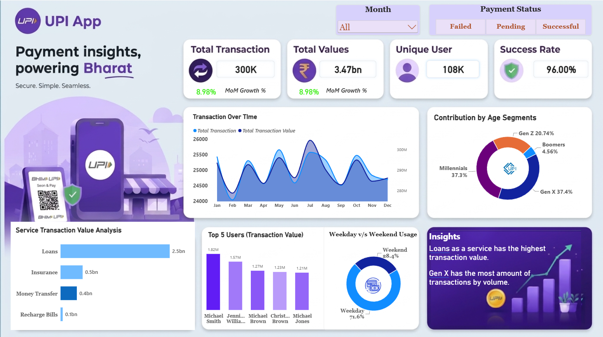

# UPI App Data Analysis

An end-to-end data analytics project focused on analyzing UPI transaction patterns, payment success rates, transaction values, customer demographics, service performance, and user behaviour using Excel and Power BI.

## Project Overview

This project analyzes UPI application data containing 300,000 transaction records and 110,002 user records to identify transaction trends and generate meaningful business insights.

The project explores payment performance, customer engagement, service-wise transaction values, demographic contributions, and usage patterns.

It presents the findings through an interactive Power BI dashboard.

## Tools & Technologies

- **Microsoft Excel:** Dataset storage and data inspection
- **Power BI:** Interactive dashboard development
- **Power Query:** Data transformation and preprocessing
- **DAX:** Measures and KPI calculations
- **Data Visualization:** Business insights and trend analysis

## Dataset Overview

The dataset consists of two worksheets:

**1. All_Users**
Contains 110,002 user records and 4 columns.

Key attributes include:
- User ID
- Name
- Age
- Join Date

**2. All_Transactions**
Contains 300,000 transaction records and 8 columns.

Key attributes include:
- Transaction ID
- Transaction Amount
- User ID
- Service
- Service Type
- Payment Status
- Transaction Reason
- Transaction Date

The dataset covers four major service categories:
- Loans
- Insurance
- Money Transfer
- Recharge & Bills

## Project Workflow

### 1. Data Inspection & Preprocessing

- Examined the structure of user and transaction datasets.
- Identified relevant columns for analysis.
- Reviewed transaction details and customer attributes.
- Prepared the data for dashboard development.

### 2. Data Analysis

Analyzed transaction and user behaviour across different dimensions:

- Transaction volume and total transaction value.
- Payment success and failure rates.
- Monthly transaction trends.
- Service-wise transaction value.
- Customer age-group contributions.
- Weekday versus weekend usage.
- Top users based on transaction value.

### 3. KPI Development

Developed key performance indicators to monitor overall UPI application performance:

- Total Transactions
- Total Transaction Value
- Unique Users
- Payment Success Rate
- Month-over-Month Growth

### 4. Power BI Dashboard

Developed an interactive dashboard featuring:

- KPI Cards for overall transaction performance.
- Monthly Transaction Trends.
- Transaction Value Analysis.
- Payment Status Filters.
- Customer Age Segment Contribution.
- Service-wise Transaction Value Analysis.
- Top 5 Users by Transaction Value.
- Weekday versus Weekend Usage.
- Interactive Month and Payment Status Slicers.
- Tooltips providing more insights on the dashboards.
- Value added texts providing more conditionals responses and overview as per the slicer conditions.

### 5. Business Insights

Key insights highlighted in the dashboard:

- Loans contribute the highest transaction value among all service categories.
- Generation X contributes the largest share of transaction volume.
- Millennials and Generation X account for significant customer contributions.
- Weekday transactions account for approximately 71.6% of usage.
- The dashboard reports an overall payment success rate of 96%.

## Dashboard Preview



## Project Structure

```text
UPI-App-Data-Analysis/
│
├── UPI-Appl-Dataset.xlsx
├── UPI_App_Data_Dashboard.png
├── UPI_App_Data_Analysis.pbix
├── README.md
└── .gitignore
```

## Future Improvements

- Perform deeper customer segmentation.
- Analyze transaction failure reasons.
- Identify seasonal transaction patterns.
- Explore customer retention and engagement.
- Develop predictive models for transaction trends.
- Add more detailed service-wise performance analysis.